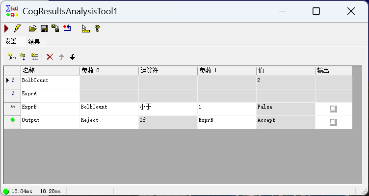
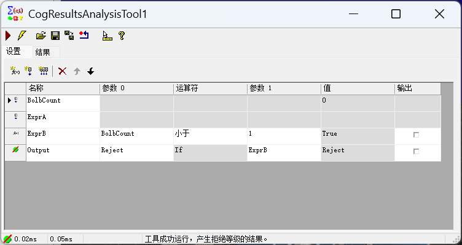
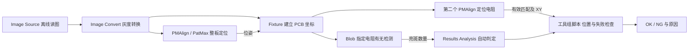

# 基于 Cognex VisionPro 的 PCB 元件定位与缺件检测

使用 VisionPro QuickBuild 搭建的离线 AOI 项目。定位 VisA PCB4 板型，检查板底 `122` 贴片电阻是否存在，测量其在 PCB 坐标系中的位置，并输出 OK/NG、Accept/Reject 和原因。

项目包含 QuickBuild 工程、公开样本、实际运行截图、批量复跑数据和面试讲解材料。

推荐打开 [PCB_AOI_position.vpp](visionpro/PCB_AOI_position.vpp)。它保留 QuickBuild 图像处理工具，增加工具组脚本处理空结果、位置范围和失败原因；[InspectionScript.cs](visionpro/InspectionScript.cs) 提供相同脚本源码。用户手工搭建并保存的版本保留在 [PCB_AOI.vpp](visionpro/PCB_AOI.vpp)。

新版已重新加载并完成原图回放和完整作业结果队列检查。项目通过工程文件、运行截图、实测记录和现场操作说明展示。真实目标偏位图片及独立测试集准确率待补充。

## 已验证结果

| 正常件 `0001` | 缺件 `046` |
| --- | --- |
|  |  |

下表为六张原图的实际开发回放，两版工程均得到相同的目标有无判定。PMAlign 分数一列属于整板定位。读取图片使用 Cognex Image File Tool。

| 样本 | 当前目标 `122` | PMAlign 分数 | 亮斑数 | 实际输出 |
| --- | --- | ---: | ---: | --- |
| `normal_0000` | 存在 | 0.999512 | 3 | Accept |
| `normal_0001` | 存在 | 0.809133 | 2 | Accept |
| `missing_046` | 缺失 | 0.768531 | 0 | Reject |
| `missing_049` | 存在 | 0.709886 | 3 | Accept |
| `wrong_place_090` | 存在 | 0.713867 | 3 | Accept |
| `wrong_place_096` | 存在 | 0.795200 | 2 | Accept |

这六张图对指定电阻的判定均与人工核对一致。`0000` 用于模板训练，`0001` 和 `046` 参与调参，其余三张用于扩展复跑。当前数据用于开发验证，独立测试集准确率待测。

`049`、`090` 和 `096` 在板上其他位置存在异常，目标 `122` 电阻仍然存在，因此本版本对它们的预期输出为 Accept。

手工版原始分数和面积见 [development_replay.json](results/development_replay.json)。新版坐标、分数、原因和逻辑检查见 [position_replay.json](results/position_replay.json)；正常、缺件、定位失败与恢复的完整作业结果包见 [position_queue_check.json](results/position_queue_check.json)。报告保留输入和工程 SHA-256。

用户实际操作的缺件结果队列 [截图](evidence/queue_046_blob0_reject.png)及早期保存检查 [记录](results/saved_queue_check.json)作为历史证据保留，属于当时的工程版本。

2026-11-19，用户在 QuickBuild 主结果窗口展开全部输出，确认正常 `0001` 的 `BlobCount = 2`、`Decision = OK`、`Reason = PASS`、`FinalOK = True`，整板和目标均找到，中心约 (215.9906, 455.9833)，偏差为 (0, 0)。[正常件完整结果截图](evidence/normal_0001_queue_fields.png)已保留。该图用于已有开发样本的界面验收。

随后用户在同一队列中验证缺件 `046`：`BlobCount = 0`、`Decision = NG`、`Reason = TARGET_MISSING`、`FinalOK = False`，`BoardFound = True`、`TargetFound = False`，坐标及偏差为 `NaN`，`ErrorDetail` 为空。[缺件完整结果截图](evidence/missing_046_queue_fields.png)已保留。正常及缺件各重复运行两次，仅涉及两张已有开发图。

## 检测流程



训练区域组合 PCB 左上板边、圆孔和 `IN+` 丝印。扩大训练范围后，同一换图样本的匹配分数由 0.583 提升到约 0.809。Fixture 使用匹配位姿建立 `PCB` 坐标空间，检测 ROI 随板件平移和旋转。

Blob 检查电阻本体上的亮色字样。早期检测框包含焊盘，缺件图也会产生亮斑。调整后的 ROI 避开焊盘，在正常件上覆盖白字，在缺件图上覆盖焊盘之间的暗色空隙。

第二个 PMAlign 使用正常 `0001` 的电阻本体作为模板，输入来自 Fixture，训练及搜索区域均使用 `@\PCB`。工具组脚本先确认整板匹配有效，再运行 Fixture；电阻匹配为空时直接给出原因，避免读取不存在的第一个结果。每帧重置输出，定位失败时发布的 `BlobCount` 为 0、坐标无效，避免沿用上一帧数据。

用户实际运行第二个 PMAlign 的 [结果截图](evidence/target_0001_position.png)显示匹配分数 0.987、X 215.99、Y 455.98。

## 位置判定的当前范围

参考中心来自正常 `0001`：X = 215.9906、Y = 455.9833。当前使用 `|X−参考X| ≤ 20` 且 `|Y−参考Y| ≤ 8` 的粗范围。单位为未标定的 PCB 坐标尺度，名义比例为 1，不能换算成毫米或作为制造公差。

| 样本 | 电阻匹配分数 | X | Y | 原图最终结果 |
| --- | ---: | ---: | ---: | --- |
| `normal_0000` | 0.859587 | 212.5598 | 456.5637 | OK / PASS |
| `normal_0001` | 0.986855 | 215.9906 | 455.9833 | OK / PASS |
| `missing_046` | 无匹配 | — | — | NG / TARGET_MISSING |
| `missing_049` | 0.697771 | 201.4572 | 458.7079 | OK / PASS |
| `wrong_place_090` | 0.841719 | 207.6506 | 455.4673 | OK / PASS |
| `wrong_place_096` | 0.855936 | 205.1375 | 456.1396 | OK / PASS |

目标存在的五张图中，X 相对参考值最大偏差约 14.53，Y 最大偏差约 2.72。当前粗范围用于容纳这些开发样本中的拍摄、定位及目标外观差异，不能据此声称具备精密偏位检测能力。电阻非极性，搜索允许 180° 方向差，当前不按该角度差拒绝。

临时把 X 允许偏差改为 0.1 后，原图 `normal_0000` 实际输出 `TARGET_OUT_OF_POSITION`；恢复 20 后，正常图重新输出 PASS。该检查只证明位置判断分支可执行。它未改变图片，也不计入真实偏位图片检测结果。按用户当前要求，没有生成 OpenCV 模拟图。

## 打开工程

运行环境为 Windows 和 Cognex VisionPro 9.0 CR2（64 位），使用包含项目所需工具的有效 VisionPro 许可。

1. 下载仓库并完整解压到本地。
2. 打开 VisionPro QuickBuild，在主窗口选择 **File → Open QuickBuild Application**，打开 `visionpro/PCB_AOI_position.vpp`。
3. 双击 `CogJob1` 进入作业编辑器。双击 `Image Source`，选择 **Choose File**，重新选定本机仓库里的 `images/raw/visa_pcb4_normal_0001.jpg`。工程携带的原取图路径需要在新机器上重新选择。
4. 点 **作业编辑器左上角红色 ▶**，运行一次完整作业。正常图预期 `BlobCount = 2`、`Decision = OK`、`Reason = PASS`。
5. 将图源切换为 `images/raw/visa_pcb4_missing_046.jpg`，再次点 **作业编辑器左上角红色 ▶**。预期 `BlobCount = 0`、`Decision = NG`、`Reason = TARGET_MISSING`。
6. 在主窗口选择 **Show → Floating Results**，点结果窗口顶部的 `▶|` 查看最新数据包。展开 `SystemProvided` 查看 Accept/Reject；展开 `UserSpecified` 查看 `Decision`、`Reason`、`BlobCount`、`TargetFound`、`TargetX/Y` 和 `DeltaX/Y`。最终判定以整个作业及这些输出为准，Results Analysis 单独显示的是原有的白字有无规则。
7. 在主窗口保存整个 QuickBuild 应用程序。详细操作和现场讲解顺序见 [演示操作说明](演示操作说明.md)。

## 当前保存参数

| 项目 | 值 |
| --- | --- |
| PMAlign 训练算法 | PatMax |
| 匹配接受阈值 | 0.60 |
| 第二个 PMAlign 训练算法 / 阈值 | PatMax / 0.50 |
| 第二个 PMAlign 训练区域 | 中心 (216, 456)，40 × 34，`@\PCB` |
| 第二个 PMAlign 搜索区域 | 中心 (216, 456)，120 × 90，`@\PCB` |
| 第二个 PMAlign 角度 / 比例 | −180°～+180° / 固定 1.0 |
| 位置粗范围 | ReferenceX/Y 见上表，ToleranceX 20、ToleranceY 8 |
| Blob 区域形状 | CogRectangleAffine |
| Blob 区域坐标空间 | `@\PCB` |
| Blob ROI 中心 | X 204.6192，Y 456.6544 |
| Blob ROI 大小 | 18 × 18 |
| Blob 分割模式 | HardFixedThreshold |
| Blob 极性 | 黑底白点 / LightBlobs |
| Blob 灰度阈值 | 110 |
| 结果分析输入 | `BolbCount`，当前工程中的实际名称 |
| 拒绝表达式 | `ExprB = BolbCount < 1` |
| Results Analysis 输出 | `Reject If ExprB`，保留有无检测规则 |
| 新版最终输出 | 工具组脚本的 `Decision`、`Reason`，以及作业 Accept/Reject |
| 新版结果列表数量字段 | 来自每帧重置后的脚本 `BlobCount` |

ROI 数值属于本工程的 `PCB` 定位坐标空间。白字可以形成两个或三个连通亮区，判定规则使用数量是否小于 1。

## 可选批量复跑

[tools/replay_project.ps1](tools/replay_project.ps1) 使用已安装的 VisionPro SDK 加载磁盘工程，逐张运行现有六张 JPG。它生成 [results/development_replay.json](results/development_replay.json)，并保留图像与工程的 SHA-256 以核对输入版本。

在仓库根目录执行以下命令。脚本运行于 Windows PowerShell 5.1，读取本地工程的独立内存副本。

```powershell
powershell.exe -NoProfile -STA -Command "& ([scriptblock]::Create([IO.File]::ReadAllText((Resolve-Path 'tools/replay_project.ps1'))))"
```

以上命令验证手工版。新版及完整作业队列使用：

```powershell
powershell.exe -NoProfile -STA -Command "& ([scriptblock]::Create([IO.File]::ReadAllText((Resolve-Path 'tools/replay_position_project.ps1'))))"
powershell.exe -NoProfile -STA -Command "& ([scriptblock]::Create([IO.File]::ReadAllText((Resolve-Path 'tools/check_position_queue.ps1'))))"
```

需要从手工版重建新版时，用同样方式运行 `tools/build_position_project.ps1`。该脚本使用 VisionPro SDK 将 `InspectionScript.cs` 编译入新工程，添加结果发布项，再用正常图检查。它写入 `PCB_AOI_position.vpp`。图像训练、匹配、定位与 Blob 仍由原 QuickBuild 工具完成。

脚本终端的初始化方式遵循 [Cognex QuickBuild 脚本说明](https://docs.cognex.com/vpro_0x091400/web/en/help/html/30157da0-b2ef-4cf2-a88c-4aadb9e4d686.htm)，并在本机 VisionPro 9.0 CR2 实际检查保存后重新加载的行为。

## 文件索引

| 路径 | 内容 |
| --- | --- |
| `visionpro/PCB_AOI.vpp` | QuickBuild 应用程序和训练模板 |
| `visionpro/PCB_AOI_position.vpp` | 推荐打开的新版：位置粗范围、失败保护及原因输出 |
| `visionpro/InspectionScript.cs` | 新版工具组脚本源码 |
| `images/reference/` | 模板训练基准图 |
| `images/raw/` | 用于换图验证的 JPG |
| `images/masks/` | 来源数据集的缺陷掩膜 |
| `images/SOURCES.md` | 原图路径、标签、作者和许可 |
| `evidence/` | 实际 QuickBuild 运行截图 |
| `results/development_replay.json` | 工程批量复跑的原始结果 |
| `results/saved_queue_check.json` | 重新加载完整作业后得到的结果包字段 |
| `results/position_replay.json` | 新版六张原图回放及单独标注的逻辑检查 |
| `results/position_queue_check.json` | 新版完整作业正常、缺件、定位失败和恢复的结果包 |
| `tools/replay_project.ps1` | 使用 VisionPro SDK 的复跑脚本 |
| `tools/build_position_project.ps1` | 从手工版生成新版工程 |
| `tools/replay_position_project.ps1` | 新版工具组回放 |
| `tools/check_position_queue.ps1` | 新版取图与已发送项队列检查 |
| [开发调试记录.md](开发调试记录.md) | 调参过程、截图证据及待验收事项 |
| [演示操作说明.md](演示操作说明.md) | 软件操作和现场讲解稿 |
| [简历与面试讲解.md](简历与面试讲解.md) | 项目描述与技术问答 |

截图演示入口见 [demo/README.md](demo/README.md)，可按顺序查看正常件和缺件的完整结果。

## 后续工作

- 准备底部 `122` 电阻真实偏位图片，验证位置规则并改进局部定位精度。
- 扩充低分匹配、图像异常和其他板型情况的检查。
- 使用新增的独立样本测量正常件误报和缺件漏检。
- 根据面试展示需要继续补充现场操作和调试案例。

## 数据来源

图像来自 Yang Zou、Jongheon Jeong、Latha Pemula、Dongqing Zhang 和 Onkar Dabeer 发布的 Visual Anomaly（VisA），使用 PCB4 子集。数据采用 CC BY 4.0，详细归属见 [images/SOURCES.md](images/SOURCES.md) 和 [第三方材料说明](THIRD_PARTY_NOTICES.md)。 [VisA 官方项目](https://github.com/amazon-science/spot-diff)
